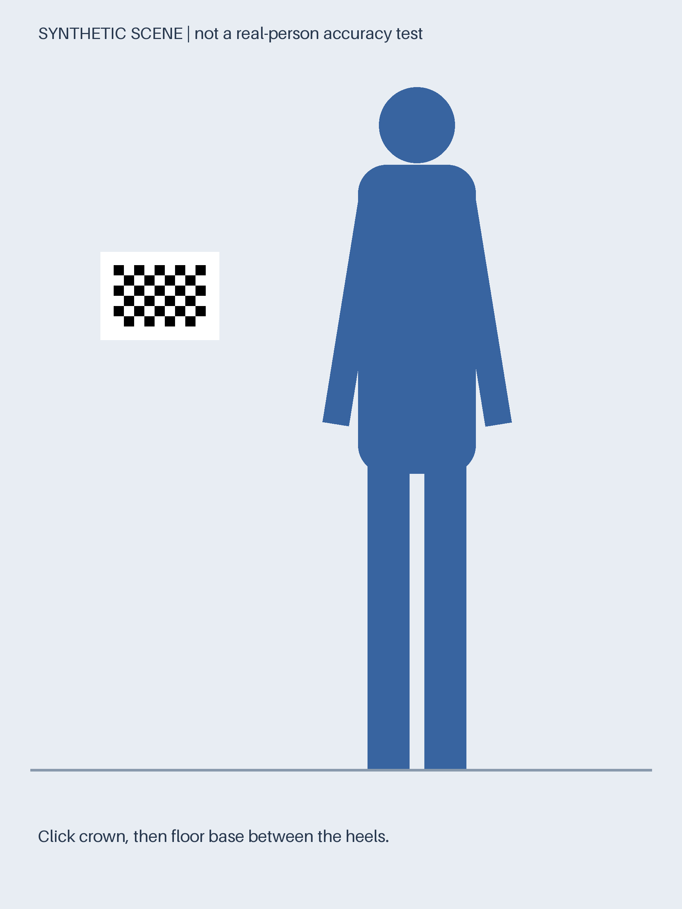

# User Guide — Single Photo Height

Estimate a standing person's height from **one photo and a chessboard reference**. An optional automatic mode proposes the crown and floor base without clicks; manual annotation remains available. Compare a simple pixel-to-metric scale with a planar homography, without a preparatory camera-calibration session.

**Status:** research prototype. Automatic endpoints require one upright person and a visible floor/wall boundary on both sides. Review the proposed points: detection does not establish measurement accuracy. The person and reference must share a plane, the printed square size must be known, and lens distortion is assumed negligible.

[Project overview](README.md) · [Guía en español](GUIA_ES.md) · [MIT license](LICENSE)



The bundled scenes are generated geometric illustrations, not photographs or evidence of real-person accuracy. The synthetic segment is 1.80 m tall.

## Quick start

Use Python **3.11**. From the repository directory, on Windows:

```powershell
python -m venv .venv
.venv/Scripts/python.exe -m pip install -r requirements.txt
.venv/Scripts/python.exe demo.py examples/frontal.png --manual
```

On macOS/Linux use `.venv/bin/python` in place of `.venv/Scripts/python.exe`. The interactive demo requires Tkinter with Tcl/Tk (included by standard Windows python.org installers; some Python distributions and Linux installations need it separately). The command-line demo does not require Tkinter.

1. Open the example or your photo with **Open photo**.
2. Click the **top of the head**. A green marker appears.
3. Click the **heel / floor base in the reference plane**. A red marker appears. For a person against a door, this is the floor–door boundary beneath them, not the forward toe tip.
4. Compare both estimates. **Correct manually** lets you reset the annotations.
5. **Save result** writes JSON and an annotated PNG under `outputs/`. The source photo is never modified.

The display scales to the window; clicks are converted back to full-resolution coordinates. Images are displayed in their EXIF orientation.

## Automatic mode: no point selection

Install the optional model runtime and explicitly download the supported model once:

```powershell
.venv/Scripts/python.exe -m pip install -r requirements-auto.txt
.venv/Scripts/python.exe download_model.py
.venv/Scripts/python.exe demo.py private_data/person.jpg
```

Opening a photo now detects the board, proposes the endpoints and displays both estimates. The green point is the crown, red is the floor base, and the cyan line is the inferred floor boundary. **Correct manually** replaces the proposal with two clicks; **Detect automatically** retries. Detection runs in a background worker; opening another image or starting a manual correction discards stale results.

For a fully unattended command:

```powershell
.venv/Scripts/python.exe measure.py private_data/person.jpg --auto --output outputs/automatic.json
```

The algorithm uses MediaPipe Pose Landmarker Full v1 for person landmarks and segmentation. It finds the crown on the head silhouette, then uses the heel locations to search for a floor/wall line supported on both sides of the body. It interpolates that line beneath the person. **It does not measure to the toe tip, assume the model's heel is on the floor, or use predicted 3D body height.** Metric conversion still uses only the chessboard and the two original estimators.

This is a heuristic for a guided capture, not automatic metrology for every photo. A skirting board or shadow can be mistaken for the floor; hair and hats can move the crown. Low visibility, bent legs, detected multiple people, or insufficient line support cause a refusal. The GUI then offers manual annotation; the CLI exits with code 2 and writes no new measurement. A successful result is still marked `review_recommended: true`, not certified accurate. Do not interpret a leftover output from an earlier run as a new successful measurement.

The generated illustration is for geometry and manual-mode testing, not a realistic pose-model benchmark. Use a real full-body photo for automatic mode. `--manual` skips inference in the GUI. `--model PATH` selects the location of the same supported, checksum-verified model bundle. No model is downloaded during measurement.

## Use your chessboard

Defaults: **9 × 6 squares**, equivalent to **8 × 5 inner corners**, with **27 mm printed square sides**. These defaults match the development experiment; change them for your actual print.

In the demo, use **Chessboard reference**: select a preset or type any `columns x rows` pattern, enter **Square side (mm)**, then click **Apply pattern** (or press Enter). Counts are squares, not inner corners. Decimal dots and commas are accepted for the physical size. The applied configuration is displayed below the controls. Changing the size preserves existing head/base points and recalculates the height; changing the layout detects the board again. A failed detection keeps the photo open so you can fix the pattern. Saving is disabled while changes are pending or the reference is not detected.

```powershell
.venv/Scripts/python.exe demo.py private_data/person.jpg --squares 9 6 --square-mm 27
```

`--squares` always counts the black/white squares, not internal corner intersections. Ordinary checkerboards are supported; ChArUco and AprilTag grids are not part of this project. The entire configured board must be visible. Measure the physical print: a label saying "20 mm" can be wrong after printer scaling.

Keep the person upright against the same plane as the reference. Capture the whole person and a sharp, well-resolved board. For simple scale, use an approximately frontal camera view. Use original-resolution photos where possible. A small or blurred board can make homography extrapolation unstable even when detection succeeds.

## Reproducible command-line demo

No graphical interface or private images are needed:

```powershell
.venv/Scripts/python.exe measure.py examples/frontal.png --head 1100 230 --base 1100 2030 --output outputs/frontal.json
```

This prints both estimates and saves `outputs/frontal.json` and `outputs/frontal_annotated.png`. The exact endpoints come from the synthetic scene, not a fitted person-height label. Expected local results are approximately **180.08 cm** for simple scale and **180.97 cm** for homography; rasterization and detected corner localization introduce small differences from the 180 cm generator segment.

For another photo, supply the correct full-image coordinates:

```powershell
.venv/Scripts/python.exe measure.py private_data/person.jpg --squares 9 6 --square-mm 27 --head 700 100 --base 700 900 --method simple_scale --output outputs/person.json
```

The coordinates in this second command illustrate syntax only. Select your photo's actual endpoints in the GUI, or replace the coordinates yourself. `--method` accepts `simple_scale`, `homography` or `both` (default).

## Two methods

| Method | Calculation | Useful when | Main limitation |
|---|---|---|---|
| Simple scale | Fit an isotropic pixels-per-meter scale using all detected corners; divide head-to-base pixel distance by that scale | Approximately frontal coplanar capture | Does not correct perspective-dependent scale changes |
| Homography | Fit a projective mapping from metric board points to image points; map the two endpoints back to the plane | A perspective mapping can be estimated reliably | Small corner errors on a small board may amplify far away at the floor |

No known person height is an input to either estimator. `reference_rms_px` describes the fit on the board, **not** uncertainty in the person's height. The tool reports failures instead of inventing missing board detections. It does not currently reject every inaccurate but numerically valid estimate.

## Evidence and limitations

A private development set contains 11 unique captures, with owner-supplied reference heights of 177 or 181 cm and confirmed 27 mm squares. The same manually reviewed head/base coordinates were used for both methods:

| Method | Mean absolute error | Maximum absolute error | Within 2 cm |
|---|---:|---:|---:|
| Simple scale | 4.63 cm | 7.22 cm | 2/11 |
| Homography | 6.28 cm | 21.12 cm | 2/11 |

These are development results on a small, related set, not independently validated accuracy. They do not establish performance across people, devices or camera angles. The photos and per-image annotations are private and are not distributed. The complete public examples and tests use only synthetic data. See [development results](README.md#development-results).

Automatic mode produced endpoints for **10/11 unique development captures** and refused one for insufficient floor-line support. On the **same ten accepted photos**, manual vs automatic MAE was **4.76 vs 5.91 cm** for simple scale and **6.32 vs 7.56 cm** for homography. Removing clicks did not improve height accuracy. These images also informed heuristic development; this is not an independent test.

## Test and regenerate examples

```powershell
.venv/Scripts/python.exe -m pip install -r requirements-dev.txt
.venv/Scripts/python.exe -m pytest -q
.venv/Scripts/python.exe generate_examples.py
```

The tests cover known metric geometry, perspective, invalid inputs, board detection, command-line outputs, source-image preservation and EXIF orientation. GitHub Actions is configured for Python 3.11 on Windows and Linux.

Automatic postprocessing tests use generated masks and landmarks and run without MediaPipe. One optional integration test runs the actual model on a blank image when the runtime and model are installed; otherwise it is explicitly skipped.

## Files

- `demo.py`: automatic proposals with manual correction.
- `measure.py`: command-line measurement and annotated output.
- `height_estimation.py`: chessboard detection and the two estimators.
- `auto_endpoints.py`: local person inference, crown extraction and floor-line selection.
- `download_model.py`: explicit model setup with pinned URL and SHA-256 verification.
- `generate_examples.py`: reproducible original synthetic illustrations.
- `tests/`: synthetic regression tests, with no private data dependency.

## Dependencies, licensing and privacy

OpenCV, NumPy, Pillow and MediaPipe are third-party dependencies with their own licenses. Automatic detection uses the externally pretrained MediaPipe Pose Landmarker Full v1 model. The model is downloaded separately and is not covered by this project's MIT license. The download URL and SHA-256 checksum are pinned in `download_model.py`. See the [official MediaPipe documentation](https://developers.google.com/edge/mediapipe/solutions/vision/pose_landmarker) and [upstream source and license](https://github.com/google-ai-edge/mediapipe).

Images are processed locally; this application's code does not upload them or add analytics. Model setup downloads a Google-hosted asset without sending photos. Keep personal photos in `private_data/` and generated measurements in `outputs/`; both are ignored by Git, as are model weights. Only the two explicitly allowed synthetic example PNGs are included in the repository.

The code and original generated examples are distributed under the [MIT license](LICENSE).

## Background

- [OpenCV: homography and planar measurement](https://docs.opencv.org/4.11.0/d9/dab/tutorial_homography.html).
- [Criminisi: Single-View Metrology](https://www.microsoft.com/en-us/research/wp-content/uploads/2016/02/criminisi_dagm2002.pdf).
- [World Bank: height measurement with a printed checkerboard](https://blogs.worldbank.org/en/opendata/survey-specialists-and-data-scientists-meet-machine-learning-measure-person-s-height-picture).
