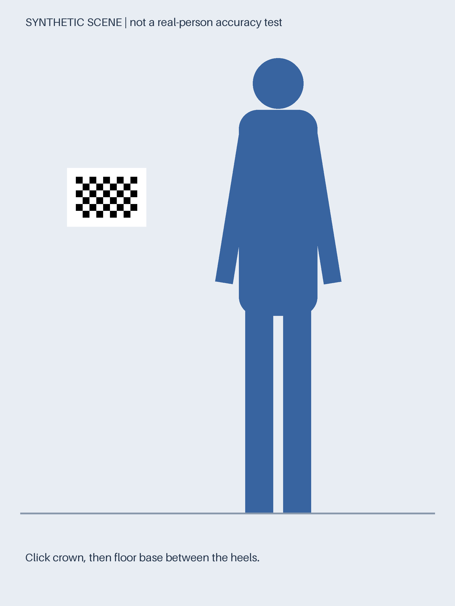

# Single Photo Height

Estimate a standing person's height from a single photograph containing a chessboard of known dimensions. Compare **simple scale** and **planar homography**, with optional automatic endpoint detection and manual correction.

[English guide](GUIDE_EN.md) · [Guía en español](GUIA_ES.md) · [MIT license](LICENSE)



## Features

- Automatic chessboard detection.
- Editable board dimensions and physical square size in the desktop interface.
- Manual head/base selection or automatic crown and floor-boundary proposals.
- Two geometric estimators: simple scale and homography.
- JSON results and annotated images, processed locally.
- Reproducible synthetic examples, regression tests and a GitHub Actions workflow.

## Quick start

Use Python 3.11. From the project directory on Windows:

```powershell
python -m venv .venv
.venv/Scripts/python.exe -m pip install -r requirements.txt
.venv/Scripts/python.exe demo.py examples/frontal.png --manual
```

On macOS/Linux, use `.venv/bin/python` instead of `.venv/Scripts/python.exe`. The desktop interface requires Tkinter with Tcl/Tk.

Select or type the board layout in **Pattern**, enter **Square side (mm)**, and click **Apply pattern**. Dimensions count squares, not inner corners. The defaults are **9 × 6 squares**, **8 × 5 inner corners**, and **27 mm per square**. Measure the physical print before using it as a reference.

For automatic detection on a real photo, install the optional runtime and download the model once:

```powershell
.venv/Scripts/python.exe -m pip install -r requirements-auto.txt
.venv/Scripts/python.exe download_model.py
.venv/Scripts/python.exe demo.py private_data/person.jpg
```

For a command-line measurement without point selection:

```powershell
.venv/Scripts/python.exe measure.py private_data/person.jpg --auto --output outputs/height.json
```

The English and Spanish guides explain the manual workflow, automatic mode, board configuration, command-line options and tests. The bundled illustrations are synthetic geometry examples; use real photographs to evaluate person detection.

## Methods and assumptions

| Method | Calculation | Main limitation |
|---|---|---|
| Simple scale | Fit a pixel-to-metric scale to the detected board and convert the head-to-base distance | Requires an approximately frontal view |
| Homography | Map the endpoints back to the metric reference plane | Corner errors can amplify far from a small board |

The person and reference must share a plane, the square size must be known, and lens distortion is assumed negligible. Known person heights are never inputs to either estimator.

Automatic mode uses person segmentation and pose landmarks to propose the crown and an interpolated floor/wall boundary near the heels. It requires one upright person and visible floor-line support on both sides. Hair, shadows, skirting boards and occlusion can affect the points. A successful detection is not proof of an accurate height; manual review remains recommended.

## Development results

This is an experimental prototype. A private development set contains 11 unique photographs with reference heights of 177 or 181 cm and confirmed 27 mm squares.

| Method | Manual MAE, 11 photos | Manual maximum absolute error |
|---|---:|---:|
| Simple scale | 4.63 cm | 7.22 cm |
| Homography | 6.28 cm | 21.12 cm |

Automatic endpoints were produced for 10 of the 11 photographs. One was rejected for insufficient floor-line support. Comparing the same ten accepted photographs:

| Method | Manual MAE | Automatic MAE |
|---|---:|---:|
| Simple scale | 4.76 cm | 5.91 cm |
| Homography | 6.32 cm | 7.56 cm |

These photographs also informed development; this is not an independent accuracy benchmark. Private photos and annotations are not distributed. Public examples and tests use synthetic data. The latest local Windows run passed 33 tests; optional GUI and model tests are skipped when their dependencies are unavailable. Remote CI results are not claimed here.

## Project files

| File | Purpose |
|---|---|
| `demo.py` | Desktop interface, pattern settings and manual correction |
| `measure.py` | Command-line measurement and result export |
| `height_estimation.py` | Chessboard geometry, simple scale and homography |
| `auto_endpoints.py` | Automatic crown and floor-base proposals |
| `download_model.py` | Explicit model download with checksum verification |
| `generate_examples.py` | Reproducible synthetic scenes |
| `tests/` | Geometry, detection, CLI and GUI regression checks |

## License and dependencies

The project's code and original synthetic examples are distributed under the [MIT license](LICENSE). NumPy, OpenCV, Pillow and MediaPipe retain their own licenses. The pretrained MediaPipe Pose Landmarker Full v1 model is an external asset downloaded separately; it is not covered by this project's MIT license. See the [official model documentation](https://developers.google.com/edge/mediapipe/solutions/vision/pose_landmarker) and [MediaPipe source](https://github.com/google-ai-edge/mediapipe).
